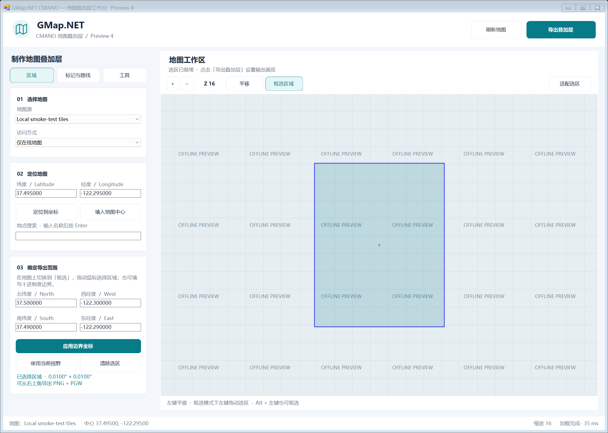

# 界面使用说明

主界面采用浅色工作台：顶部是刷新和导出入口，左侧是「区域 / 标记与路线 / 工具」三个页面，右侧为地图。设置面板可垂直滚动；地图随窗口大小变化。字体与自绘按钮随显示器 DPI 缩放。

## 设置代理服务器

在「区域 → 01 选择地图」卡片中点击「代理与连接设置…」。

- **直连**：程序不使用代理。
- **使用 Windows 系统代理**：读取 Windows 的系统代理配置。
- **手动 HTTP 代理**：填入自己的代理地址，例如 `http://127.0.0.1:7890`；也可以省略 `http://`。本地代理软件请使用 HTTP / Mixed 端口，端口号以自己的配置为准。
- 有认证要求时填写用户名和密码；无认证时留空。
- 连接超时默认 **15 秒**，慢速连接可调到 **30 秒**，范围为 5～120 秒。

点击「保存并应用」后会刷新当前地图，地址无效时会在窗口内提示，并保留原设置。地图浏览、地点搜索、路线和导出下载共用设置；当前选区和访问方式保留。「仅本地缓存」仍不会联网。

设置自动保存到 EXE 同目录的 `settings/network.xml`。密码由 Windows 当前用户加密，复制到其他用户或电脑后需要重新填写密码。

如果设置正确后仍有少数图源超时或服务器不可用，可切换其他地图源；旧图源停服或没有当前区域影像时，代理无法解决。

## 制作一张叠加层

1. 在「区域」页面选择地图源和访问方式。需要断网使用时选择「仅本地缓存」。
2. 输入纬度、经度，点击「定位到坐标」，也可填写地点名称后按 Enter 搜索。「填入地图中心」可以复制当前中心的坐标。
3. 在地图上点击「框选区域」，然后用左键拖动选择范围。切回「平移」后可以继续移动地图，也可在平移模式按住 Alt 用左键框选。
4. 检查北、南纬度与西、东经度。可以直接修改这些十进制度数值，再点击「应用边界坐标」。「使用当前视野」选择当前可见地图，「适配选区」将选区完整显示在工作区。
5. 点击右上角「导出叠加层」，或按 Ctrl + E。没有选区或路线时，导出按钮保持禁用。
6. 在导出窗口设置缩放级别、大小上限和 PNG 路径。原始像素尺寸和近似地面分辨率会随设置更新。默认使用当前地图的缩放级别。
7. 保留「生成 PGW 定位文件」以制作 CMANO 叠加层，点击「开始导出」。下载进度与完成结果在窗口底部显示。

纬度范围为 −90～90，经度范围为 −180～180；南纬、西经用负数。例如西北角可填写北纬度 `37.50`、西经度 `-122.30`，东南角填写南纬度 `37.49`、东经度 `-122.29`。北纬度应大于南纬度，东经度应大于西经度。跨 180° 经线的区域请分成两张叠加层导出。

## 输出画质与文件

像素尺寸预览是拼接地图的原始尺寸，不是缩小后文件的最终尺寸。地图缩放级别越高，所需原始像素越多；实际影像细节也取决于地图源。

大小上限仍默认 10 MB，超过时沿用旧的缩图规则。若希望减少缩图，可以适当提高上限，或者使用同时保留的带时间戳原始 PNG。原始 PNG 与所选路径的 PNG 各有自己对应的 PGW，使用时保持同名文件配对。大范围和高纬度的投影/对齐限制见 [画质与坐标改进计划](ROADMAP.md)。

导出开始后设置暂时禁用，可以点击「取消导出」。导出期间关闭窗口会先取消任务，待任务结束后关闭；取消不会自动删除已经写入的文件。一次只打开一个导出窗口。

## 标记、路线与工具

- 「标记与路线」保留当前标记、固定标记、多边形、路线起终点、GPX 导入导出和移动 GPS 日志。
- 「工具」提供打开、导入、导出和清理缓存，以及选区预下载、视图截图、缩放滑块与瓦片网格。
- 度分秒输入也在「工具」中。度栏使用方向前缀，如 `N31`、`S12`、`E121`、`W122`，分与秒分别填写。
- 旧版航班、车辆、性能和 TCP/IP 演示保留在工具页面下方，其外部服务的可用性尚未全面验证。

## 连续预下载选区

先在地图上框选区域，再打开「工具 → 本地缓存」。可设置「预下载到缩放等级」，默认采用当前图源在控件中的最大等级。点击「预下载选区地图」后，会从当前缩放等级连续处理到结束等级，开始、各级完成和最终结束都不再弹确认框。

一个进度窗口显示当前等级和瓦片进度；完成后自动关闭，结果显示在缓存「状态」栏。已有缓存自动跳过，新下载瓦片直接写入 EXE 同目录的缓存，即使当前访问方式为「仅在线地图」也会保存预下载结果，且不会改变原访问方式。

点击「取消下载」、按 Esc 或关闭进度窗口会停止整个任务。程序会等待当前请求结束后关闭，已经写入的瓦片保留，不会继续下一个等级。「仅本地缓存」模式只检查已有瓦片，不连接服务器。

## 预览与验证

以下为本机 144 DPI（150% 缩放）的真实 WinForms 窗口。地图使用离线测试网格，便于检查界面，不是在线地图画质示例。

自动验证包含窗口布局、导航、坐标校验、实际鼠标框选、真实按钮触发的后台导出、PNG/PGW 输出及便携缓存读写，并检查实际按钮触发的三级连续预下载、缓存复用与取消。
